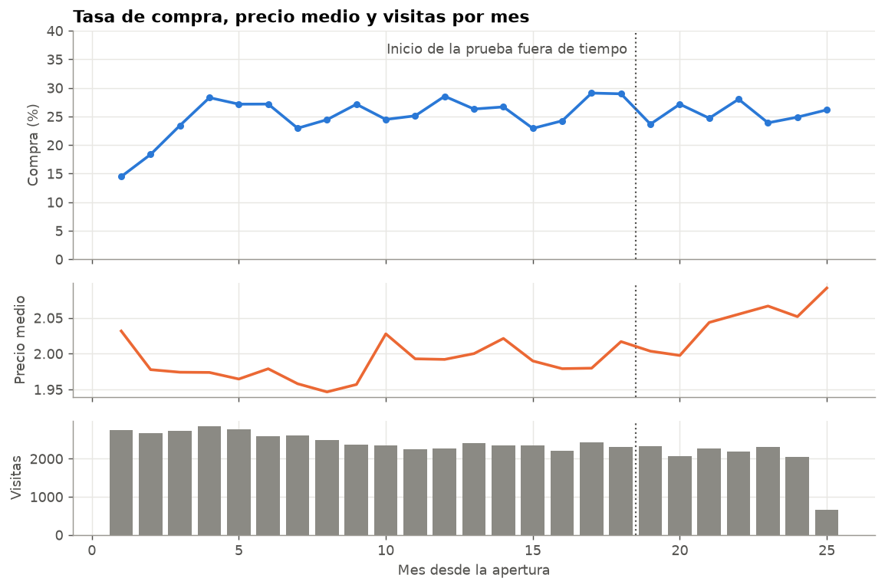
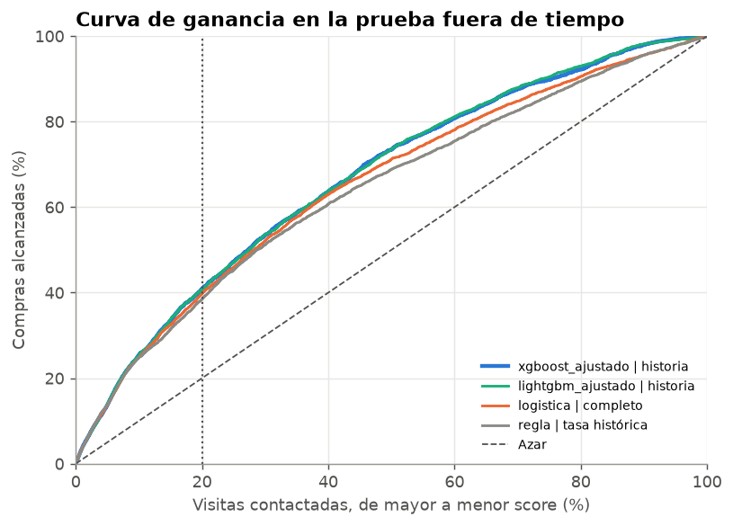
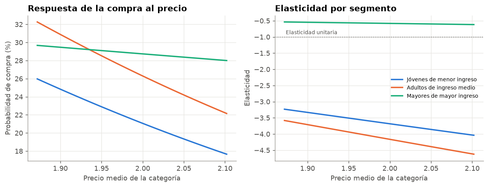

# Propensión de compra y elasticidad de precio

¿Qué visitas de una tienda terminarán en compra, y de qué marca? ¿Cuánto cambia esa probabilidad cuando cambia el precio? ¿A quién conviene darle un descuento? Este proyecto separa tres preguntas que suelen mezclarse: **quién compra**, que se responde con un modelo de propensión; **qué marca elige**, que se responde con un modelo de elección; y **cuánto responde la compra al precio**, que se responde con elasticidades por segmento y por marca.

**Notebook principal:** [nb_01_propension_elasticidad.ipynb](nb_01_propension_elasticidad.ipynb)

## Resultado

**Quién compra.** Un XGBoost ajustado con solo 4 variables de historia del cliente: tasa histórica de compra, días desde la última compra, marca de la visita anterior y días desde la visita anterior. LightGBM con las mismas variables rinde igual.

| Modelo | Variables | Gini OOT (IC 95 %) | Compra con cupo de 20 % |
|---|---|---|---|
| **Elegido:** XGBoost ajustado, historia | 4 | **0.448** (0.406 a 0.488) | 51.4 % |
| LightGBM ajustado, historia | 4 | 0.451 (0.410 a 0.491) | 51.3 % |
| LightGBM ajustado, todas las candidatas | 30 | 0.440 (0.399 a 0.480) | 51.1 % |
| Campeón: logística, todas las candidatas | 30 | 0.405 (0.360 a 0.449) | 50.0 % |
| Regla: tasa histórica de compra | 1 | 0.371 (0.320 a 0.418) | 48.4 % |
| Azar | 0 | 0 | 25.2 % |

La prueba fuera de tiempo (OOT) son los últimos seis meses: 13,331 visitas. El Gini mide qué tan bien ordena un modelo: 0 equivale al azar y 1 a un orden perfecto.

**Cuánto responde la compra al precio.** Elasticidad de la probabilidad de compra frente al precio medio de la categoría:

| Segmento | Clientes | Elasticidad | IC 95 % (remuestreo de días) |
|---|---|---|---|
| Jóvenes de menor ingreso | 187 | −3.68 | −5.70 a −0.88 |
| Adultos de ingreso medio | 206 | −4.16 | −6.08 a −2.37 |
| Mayores de mayor ingreso | 107 | −0.58 | −3.28 a 0.90 |
| **Total** | 500 | **−3.29** | −4.75 a −0.74 |

**Qué marca compra.** Al combinar la propensión con un modelo multinomial de elección de marca se estima la probabilidad de comprar cada marca:

| Marca | Participación en compras | Elasticidad total a su precio | Gini OOT: propensión × elección | Gini OOT: regla por marca |
|---|---|---|---|---|
| 1 (la más barata) | 9.2 % | −6.79 | **0.529** | 0.515 |
| 2 | 31.0 % | −2.44 | **0.627** | 0.560 |
| 3 | 5.7 % | No identificable | 0.755 | **0.790** |
| 4 | 20.0 % | −2.08 | 0.784 | **0.798** |
| 5 (la más cara) | 34.0 % | −0.51 | **0.863** | 0.842 |

**A quién darle un descuento de 5 %.** El 20 % de las visitas de la prueba OOT recibe la oferta, con un margen ilustrativo de 30 %:

| Estrategia | Compras incrementales | Compras subsidiadas | Margen incremental |
|---|---|---|---|
| Mayor propensión | 113 | 1,473 | −272 |
| Mayor aumento de probabilidad | 166 | 1,008 | −50 |
| **Mayor margen incremental** | 111 | 420 | **+37** |
| Al azar | 95 | 683 | −66 |

## Qué se concluye

- **Menos variables rinden al menos igual.** La selección de variables descartó 22 de 30 candidatas, entre ellas todas las de precio, y el modelo elegido usa 4 de las 8 restantes. Rinde al menos igual que LightGBM con las 30 (+0.007 de Gini, IC de −0.000 a +0.015), y agregarle las variables de precio baja su Gini OOT a 0.431.
- **El algoritmo importa menos que las variables y el ajuste fino.** XGBoost y LightGBM ajustados empatan (0.448 y 0.451 fuera de tiempo). Sin ajuste, XGBoost queda muy atrás, porque sus valores por defecto generan árboles demasiado profundos.
- **El precio no sirve para ordenar clientes, pero sí para decidir precios.** Es el mismo para todos en un día y cambia por épocas, así que no dice quién compra más. Sí dice cuánto se compra: subir los precios 1 % reduce la probabilidad de compra alrededor de 3.3 % en el corto plazo.
- **La elasticidad de corto plazo exagera el efecto de un cambio sostenido.** En la prueba OOT el precio medio subió 2.8 % y la compra no cayó (25.2 %). El modelo de precio anticipaba 23.3 %. El cliente elige en qué visita comprar según el precio del día.
- **Bajar el precio general aumenta el volumen, pero reduce el margen.** Con −5 %, las compras suben 14.3 % y el margen cae 5.2 %. Los mayores de mayor ingreso casi no responden al precio.
- **Dar descuentos a quien más probablemente compra destruye margen.** Esa estrategia subsidia 1,473 compras que habrían ocurrido igual. Solo gana dinero la que elige visitas de baja propensión en los segmentos elásticos, y la ganancia es pequeña.
- **La marca la decide la lealtad, y el precio decide cuánto.** La marca más comprada por el cliente acierta en 78.5 % de las compras. La marca 1 es muy sensible a su precio y le quita clientes a la marca 2. La marca 5, la premium y la más vendida, casi no responde a su precio.
- **Con cupos pequeños, la regla simple basta.** Con 5 % y 10 % de las visitas, modelo y tasa histórica son equivalentes. Desde 20 %, el modelo es mejor (+1.2 a +4.4 puntos de compra).

**Recomendación:** usar el modelo de 4 variables para priorizar acciones con cupos de 20 % o más y el modelo combinado para acciones por marca. No bajar el precio general y probar un aumento moderado con un diseño controlado, empezando por la marca 5. Cualquier descuento personalizado debe lanzarse como piloto con un grupo de control aleatorio, porque el margen incremental proviene de una elasticidad estimada con datos históricos.







## Metodología

1. **Calidad de datos.** Revisión de unicidad y coherencia, y contraste de cada columna con el diccionario. Dos columnas no contienen lo que su nombre indica, y los últimos tres días del archivo están incompletos.
2. **Variables sin fuga.** 30 candidatas de historia, precio y perfil, calculadas solo con visitas anteriores. `id_marca` y `cantidad` se excluyen porque son el resultado de la visita.
3. **Análisis exploratorio.** Patrones de tiempo, precio, promociones, historia y perfil del cliente.
4. **Validación temporal.** El modelo se elige con tres bloques de desarrollo, entrenando siempre con días anteriores. Los últimos seis meses se reservan como prueba final.
5. **Segmentación.** K-Means sobre el perfil demográfico, con el número de grupos elegido por estabilidad bootstrap.
6. **Selección de variables.** Concentración, PSI, IV y Gini por bloque, coherencia de signo, correlación de Spearman y VIF, calculados solo con datos de desarrollo.
7. **Campeón, retadores y ajuste fino.** Regla simple, logística, LightGBM y XGBoost, estos dos con valores por defecto y con búsqueda aleatoria de hiperparámetros: 16 configuraciones, elegidas con una regla de robustez y parsimonia.
8. **Evaluación final.** Gini, tasa en el cupo y bootstrap pareado por cliente para los intervalos de confianza.
9. **Calibración y sensibilidad.** Calibración por decil, demanda semanal, validación aleatoria, clientes no vistos, grupos de variables y semillas.
10. **Interpretabilidad y equidad.** SHAP, odds ratios y comparación por género, edad y segmento.
11. **Elasticidad de precio.** Logística por segmento, intervalos por remuestreo de días, seis especificaciones de robustez y una prueba de nivel fuera de tiempo.
12. **Elección de marca.** Regresión multinomial con precios, promociones y lealtad, con elasticidades propias y cruzadas por marca.
13. **Captura de valor.** Tabla por cupo, simulación de precios, estrategia de descuentos, indicadores por área, arquitectura en la nube y plan de monitoreo.

## Datos

Se usa el archivo `compras_data.csv`, con 58,693 visitas de 500 clientes durante 730 días. Cada fila es una visita e incluye si hubo compra, la marca y la cantidad, los precios y promociones del día de 5 marcas de una categoría y el perfil del cliente (género, estado civil, edad, educación, ingreso y ocupación).

El archivo y su diccionario se recibieron como parte de una prueba técnica y no se incluyen en este repositorio. Para ejecutar el notebook, copia `compras_data.csv` a la carpeta `data/` de este proyecto.

## Cómo ejecutarlo

Probado con Python 3.14. Dentro de `purchase-propensity-price-elasticity`:

```powershell
python -m venv venv-purchase-propensity-price-elasticity
.\venv-purchase-propensity-price-elasticity\Scripts\python.exe -m pip install -r requirements_purchase-propensity-price-elasticity.txt
```

Abre el notebook, selecciona ese entorno como kernel y ejecuta todas las celdas. La ejecución completa toma unos tres minutos. Con `SEMILLA = 42` se reproducen los resultados de este documento.

**Puntuar sin el notebook.** El notebook guarda los modelos en `modelo/modelo_propension.joblib`. El script `puntuar.py` los carga y devuelve, para la última visita de cada cliente, la probabilidad de compra y la de cada marca:

```powershell
.\venv-purchase-propensity-price-elasticity\Scripts\python.exe puntuar.py --historial data/compras_data.csv --salida puntuaciones.csv
```

La última fila de cada cliente es la visita a puntuar, con los precios del día; sus columnas de resultado pueden ir vacías. El notebook verifica que el script reproduzca exactamente sus probabilidades.

## Estructura

```
purchase-propensity-price-elasticity/
├── nb_01_propension_elasticidad.ipynb                      Análisis completo
├── puntuar.py                                              Puntuación fuera del notebook (línea de comandos)
├── requirements_purchase-propensity-price-elasticity.txt   Dependencias con versiones exactas (Python 3.14)
├── modelo/                                                 Modelos guardados por el notebook
├── img/                                                    Gráficos de este documento
├── entregables/                                            Código en .txt, documentación en Word y PDF, y presentación en PDF
└── data/                                                   Coloca aquí el CSV (no se versiona)
```

## Tecnologías

Python, pandas, NumPy, scikit-learn, LightGBM, XGBoost, joblib y Matplotlib.

## Limitaciones

- **La elasticidad es de corto plazo.** Se estima con variaciones de un día a otro y exagera el efecto de un cambio de precio sostenido.
- **El precio no fue asignado al azar.** Las promociones pueden coincidir con otras acciones de la tienda que no están en los datos.
- **Propensión no es efecto causal.** El margen incremental de los descuentos combina dos modelos y debe validarse con un grupo de control.
- **La elección no es ciega.** La regla que limita la elección a modelos con variables seleccionadas se definió después de una primera corrida, en la que la regla anterior elegía al campeón (Gini OOT de 0.405). XGBoost se agregó como retador en una revisión posterior, cuando ya se sabía que fuera de tiempo rendía igual que LightGBM; la regla lo eligió por una diferencia de 0.003 que es ruido.
- **Siempre son los mismos 500 clientes.** La prueba OOT mide visitas futuras de clientes conocidos. Con 100 clientes no vistos en el entrenamiento, el Gini es 0.390.
- **Equidad.** El modelo ordena peor entre los jóvenes de menor ingreso (Gini 0.351), que reciben 14.3 % de las ofertas frente a 28.6 % del grupo de 45 a 59 años.
- **Diccionario incompleto.** No se documenta qué significan los códigos de género, estado civil, educación y ocupación.
- **Sin cantidad.** No se modela cuántas unidades se compran. Las simulaciones de ingreso suponen que la cantidad y la marca elegida no cambian con el precio.
- **La marca 3 no es identificable.** Su precio casi no varía y su elasticidad estimada tiene un signo incoherente.
- **Valores ilustrativos.** El margen de 30 % y el descuento de 5 % no provienen de la tienda.
